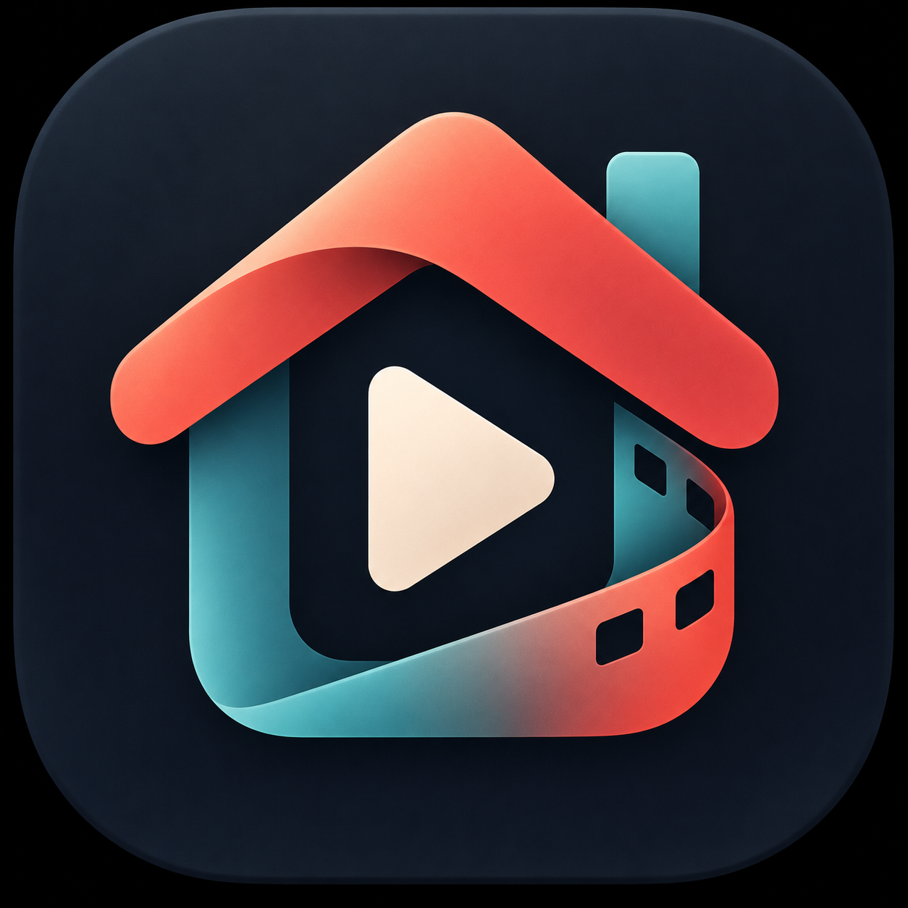
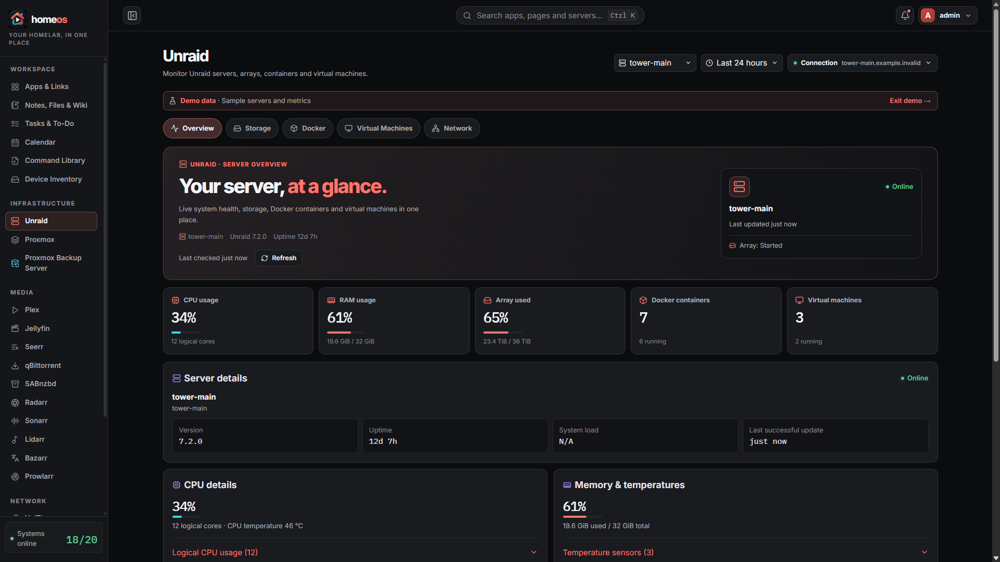
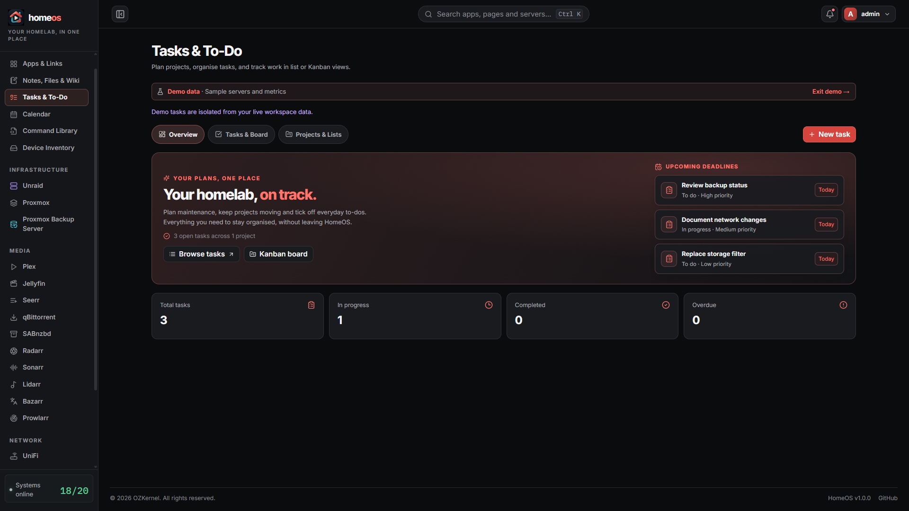

<div align="center">



# HomeOS

**Your homelab. One dashboard.**

A self-hosted home dashboard for infrastructure, media, network services, and personal tools.

[Installation](INSTALLATION.md) · [Features](#features) · [Screenshots](SCREENSHOTS.md) · [Support](SUPPORT.md) · [Report a bug or idea](https://github.com/ozkernel/homeos/issues/new/choose)

</div>



## About HomeOS

HomeOS is an **independent, AI-assisted project** developed by ozkernel. I'm learning software development as I build it, and I welcome respectful, constructive technical feedback and bug reports.

This repository is the **public installer and documentation repository**. It **does not contain HomeOS's proprietary application source code**. Install HomeOS using the official Docker image.

## Features

- **Infrastructure:** Unraid, Proxmox VE and Proxmox Backup Server.
- **Network:** UniFi and AdGuard Home.
- **Media:** Plex, Jellyfin, Seerr, Radarr, Sonarr, Lidarr, Bazarr, Prowlarr, qBittorrent and SABnzbd.
- **Workspace:** Calendar, notes, files, tasks, wiki and app shortcuts.
- **Customisation:** Dashboard widgets, themes, layouts and user management.
- **Demo Mode:** Explore example data before connecting services.

Features vary depending on your integration setup and the permissions you grant. HomeOS connects to third-party services; it does not host or supply media.

## Installation

**Requirements:** Docker with Linux containers on Linux amd64.

HomeOS v1.0.0 is installed from the official Docker image `ghcr.io/ozkernel/homeos:1.0.0`. See [GitHub Releases](https://github.com/ozkernel/homeos/releases) for release notes.

### Docker Compose

```sh
git clone https://github.com/ozkernel/homeos.git
cd homeos
cp .env.example .env
docker compose config --quiet
docker compose pull
docker compose up -d
```

By default, Compose binds to `127.0.0.1:3080` (host-local). To access HomeOS on a trusted LAN, change `HOMEOS_BIND` in your **local** `.env` to `0.0.0.0` before starting. Never publish your `.env`.

See the [complete installation guide](INSTALLATION.md), including **Unraid installation**, storage, first-run setup and backups.

### Unraid

An [Unraid user template](templates/homeos.xml) is included. Follow [Unraid instructions](INSTALLATION.md#unraid) to install HomeOS. Inclusion here does not mean the application is listed in Unraid Community Applications.

## Screenshots



[More screenshots](SCREENSHOTS.md) · Screenshots use demo data.

## Community and support

Use [GitHub Issues](https://github.com/ozkernel/homeos/issues/new/choose) to report a bug or suggest a new idea. Choose **Bug report** or **Idea / feature request**. GitHub Discussions is not used. Please keep feedback constructive. This project is AI-assisted, and I'm learning as it evolves.

- [Support and troubleshooting](SUPPORT.md)
- [Configuration and integrations](CONFIGURATION.md)
- [Security reporting](SECURITY.md)
- [Contributing](CONTRIBUTING.md)
- [Code of conduct](CODE_OF_CONDUCT.md)

## Licence and acknowledgements

HomeOS's own application code is **proprietary**, not open source. A public repository does not mean the application code is freely licensed. See [HomeOS licence](LICENSE.md), [third-party notices](THIRD_PARTY_NOTICES.md), and [third-party source information](THIRD_PARTY_SOURCES.md). The individual third-party licences continue to apply to those components.

HomeOS is not affiliated with Unraid, Proxmox or the other projects it integrates with.
